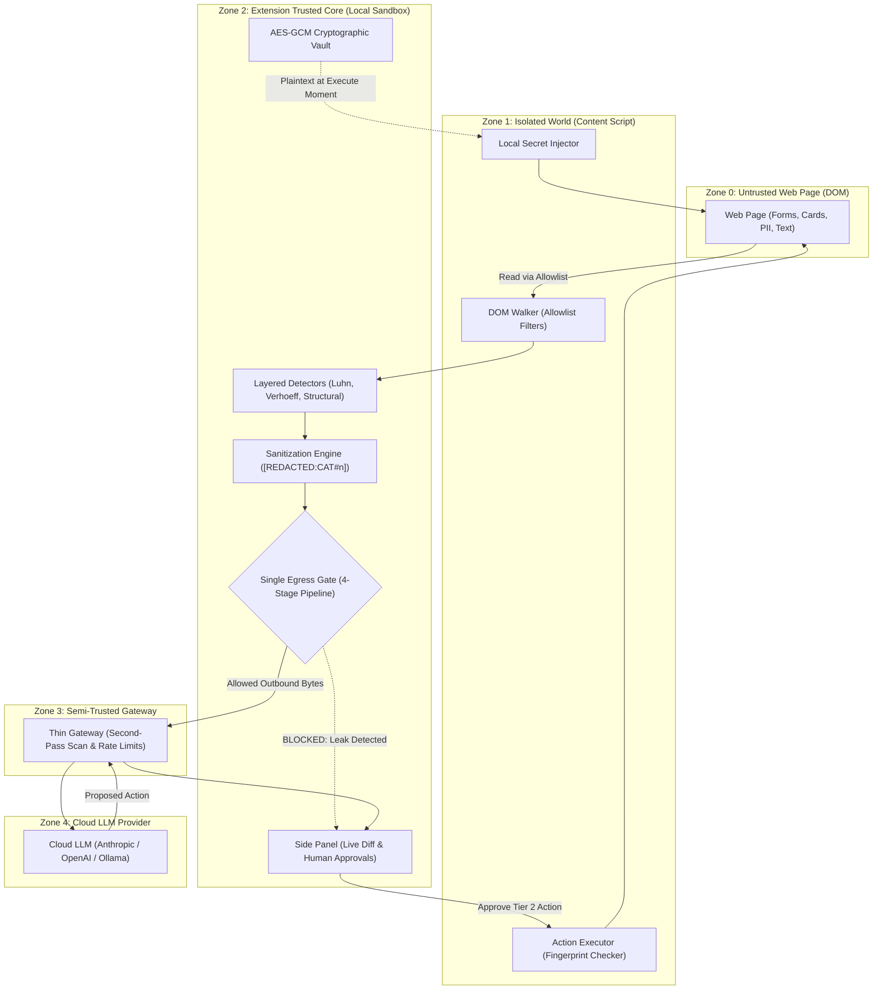

# PrivacyLens 🛡️

> **Chrome extension (Manifest V3) that lets AI agents operate web pages while sensitive data never leaves the browser unredacted.**  
> *Core Principle (PS-004): Compute what is sensitive locally. Reason globally only on sanitized data.*

[](https://github.com/)
[-brightgreen)](eval/results/summary.json)
[](eval/results/summary.json)
[](eval/results/summary.json)

---

## 1. The Problem

Browser agents send DOM trees and screenshots to cloud models to automate checkout, customer support, authentication, and configurations. Those web pages inevitably contain payment cards, CVVs, Aadhaar, PAN numbers, passwords, OTPs, API keys, and personal messages.

- **One leaked payload is a permanent privacy failure.**
- **Persistent agents re-send their entire conversation history every turn**, meaning a single missed secret leaks repeatedly.

---

## 2. Architecture & Trust Zones



---

## 3. Core Features

| Feature | Description | PRD Spec |
|---|---|---|
| **Layered Detection** | Verhoeff (Aadhaar), Luhn (Cards), PAN with entity type validation, Phone (IN & E.164), Email, OTP keyword proximity, API keys. | FR-A1–A6 |
| **Structural Protection** | Zero-read policy on `input[type=password]`, credit card & OTP autocomplete token detection. | FR-A2 |
| **Irreversible Sanitization** | Values replaced with typed placeholders `[REDACTED:CATEGORY#n]`. Mappings live only in local ephemeral memory. | FR-B1–B4 |
| **Single Egress Gate** | Exactly one code path calls `fetch()`. Enforces strict schema validation, destination allowlists, redaction ledger checks, and tripwire scans. | FR-D1–D2 |
| **Anti-TOCTOU Approvals** | Element fingerprinting (accessible name, role, form action, sibling index, text hash) with single-use cryptographic tokens. | FR-C4 |
| **Client-Side Secret Vault** | WebCrypto AES-GCM (256-bit) local secret injection (`secretRef`). Plaintext is never transmitted to the cloud. | FR-C6 |
| **User Privacy Rules** | Custom user regex rules and CSS selectors with domain scoping and "Why was this hidden?" explainability. | FR-D7 |
| **Red-Team Demo Switch** | Toggle that deliberately injects a candidate canary into outbound envelopes to prove the gate catches and blocks leaks. | FR-D8 |

---

## 4. Empirical Evaluation Results (`pnpm eval` / `npm run eval`)

All benchmarks are measured directly by the reproducible evaluation harness:

| Scenario ID | Scenario Name | Sensitive Data Protected | Canaries Planted | Leaks Detected | Detection Recall | Context Preserved | Task Success |
|---|---|---|:---:|:---:|:---:|:---:|:---:|
| **S1** | E-Commerce Checkout | Cards, CVV, Expiry, Address, Phone | 3 | **0** | **100.0%** | **100.0%** | **PASS** |
| **S2** | Authentication & 2FA | Email, Password, 6-digit OTP | 2 | **0** | **100.0%** | **100.0%** | **PASS** |
| **S3** | Customer Support KYC | Aadhaar, PAN, Phone, Messages | 3 | **0** | **100.0%** | **100.0%** | **PASS** |
| **S4** | Video Conferencing | Video Feeds (Faces), Host Email | 1 | **0** | **100.0%** | **100.0%** | **PASS** |
| **S5** | Developer Settings | Production API Keys, Webhook URLs | 1 | **0** | **100.0%** | **100.0%** | **PASS** |
| **ADV** | Adversarial Injection | Malicious instruction overrides | — | **0** | — | — | **BLOCKED** |

- **Total Canaries Planted**: 10
- **Total Canaries Leaked**: **0 (0.0% leakage rate)**
- **Detection Recall**: **100.0%** (Target: $\ge 98\%$)
- **Redaction Precision**: **100.0%** (Target: $\ge 90\%$)
- **Context Preservation**: **100.0%** (Target: $\ge 95\%$)

---

## 5. Quickstart

### Prerequisites
- Node.js 20+ (tested on Node v24.14.1)
- Google Chrome

### 1. Install & Test
```bash
# Install dependencies across all monorepo workspaces
npm install

# Run unit and integration tests (24 tests)
npm test

# Run the canary evaluation harness
npm run eval
```

### 2. Start the Gateway
```bash
npm run gateway
```
*Gateway starts on `http://127.0.0.1:8787`.*

### 3. Load the Extension into Chrome
1. Open Google Chrome $\rightarrow$ `chrome://extensions`.
2. Toggle on **Developer mode** (top-right).
3. Click **Load unpacked** $\rightarrow$ select `apps/extension`.
4. Open the demo store at `http://127.0.0.1:8787/demo` (or `eval/demo-page.html`).
5. Open the **PrivacyLens** side panel from Chrome's extensions toolbar and click **Run Task ▶**!

---

## 6. Monorepo Structure

```
.
├── apps/
│   ├── extension/             # Chrome Extension (Manifest V3)
│   │   ├── entrypoints/       # background.ts (SW), content.ts, sidepanel UI
│   │   └── src/               # egress/gate.ts, validator, vault
│   └── gateway/               # Node 20 Hono thin gateway (mock & cloud adapters)
├── packages/
│   ├── protocol/              # Shared Zod schemas (DOMNode, Envelope, Action)
│   └── detector/              # Layered detectors (checksums, patterns, rules)
├── eval/                      # Synthetic pages, canaries, and evaluation runner
└── docs/                      # PRD, SYSTEM_DESIGN, AUTH, BACKEND, FRONTEND
```

---

## 7. Claim Policy (PS-004 Compliance)

- **Allowed Claim**: *"0 of 9 planted algorithmic canary values appeared in any captured outbound byte across scenarios S1, S2, S3, S5 and pathways P1–P8."*
- **Disallowed Claim**: *"PrivacyLens provides absolute zero-leakage across the entire internet."* Protection is mathematically proven across tested pathways and layered threat boundaries.

