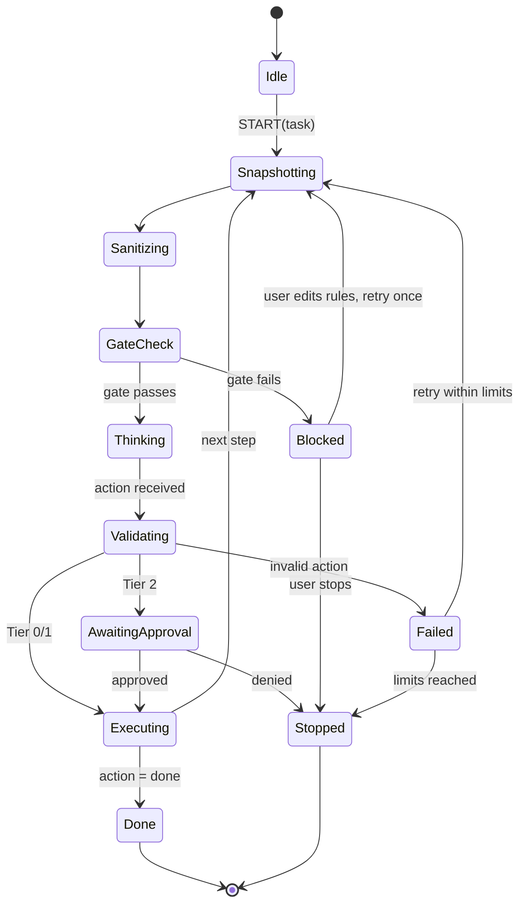

# PrivacyLens — Frontend (Extension UI) Specification

Related: `SYSTEM_DESIGN.md` (components, snapshot, gate), `AUTH.md` (approval binding).

---

## 1. Surfaces

| Surface | Tech | Purpose |
|---|---|---|
| **Side panel** (primary) | React + TS | Task input, privacy preview, approvals, run log |
| Toolbar popup | Minimal HTML | Status dot + "open panel" button |
| Options page | React | Settings, privacy rules, vault, modes |
| Content-script overlay | Closed shadow DOM | **Read-only** redaction highlights and tooltips on the page |
| Offscreen document | Headless | OCR / face / NER workers (no UI) |

The side panel is chosen because it persists across page navigations and cannot be styled, overlaid, or scripted by the page. **Anything that needs trust (approvals, the outbound payload view) lives there and never in the page DOM.** [Certain]

## 2. Stack

| Concern | Choice | Why |
|---|---|---|
| Build | WXT (fallback: Vite + hand-written manifest) | MV3 scaffolding, HMR for content scripts. [ASSUMPTION: verify WXT still works with current Chrome before committing; fall back if it fights us] |
| UI | React 18 + TypeScript | |
| Styling | Tailwind | Fast, no design system needed |
| State | Zustand | Small; mirrors run state from the service worker |
| Schemas | zod from `packages/protocol` | Same types as gateway |
| Tests | Vitest + Testing Library; Playwright with the loaded extension | |

## 3. Run state machine

The service worker owns truth; the UI renders it.



## 4. Screens

### 4.1 Run screen (side panel)

```
┌──────────────────────────────────────┐
│ PrivacyLens        ● DOM-only  [⚙]   │
├──────────────────────────────────────┤
│ Task: [ Buy the cheapest item......] │
│                          [ Run ▶ ]   │
├──────────────────────────────────────┤
│ Step 3 / 15            Status: Thinking │
│ ┌──────────────────────────────────┐ │
│ │ ⛨ Protected: 6 values hidden     │ │
│ │   CARD 1 · CVV 1 · EMAIL 2 ·     │ │
│ │   PHONE 1 · PASSWORD 1           │ │
│ │ [View what the model sees ▸]     │ │
│ └──────────────────────────────────┘ │
│ ── Timeline ──                       │
│ ✓ 1 scroll         T0                │
│ ✓ 2 click "Add to cart"   T1         │
│ ● 3 click "Pay now"       T2 ⚠ wait  │
└──────────────────────────────────────┘
```

### 4.2 Privacy preview (FR-D5)

Two panes, plus a header that states the verdict.

- **Left, "On the page"**: the local view, with sensitive spans highlighted by category color. Local only; this is the user's own data.
- **Right, "Sent to the model"**: the **exact serialized bytes** the gate approved, pretty-printed, with placeholders highlighted. This must be the real gate output (the same variable that is sent), not a re-render. [Certain: a preview that is built separately from the sent payload can drift and would mislead the user and the judges.]
- Header: `Allowed · 14 KB · 6 redactions · 0 tripwire hits` or `BLOCKED · CARD at tree[12].text`.
- Click a highlighted span → **Why was this hidden?** card: `category: CARD · source: regex + checksum · rule: card.luhn.v1 · confidence 0.99`. (FR-D7, explainability)
- Screenshot mode: thumbnail of the redacted image with default-deny regions outlined.

### 4.3 Approval card (Tier 2)

```
┌──────────────────────────────────────┐
│ ⚠ Approval needed                    │
│ Click  "Pay now"                     │
│ Why:   Submits a payment form        │
│ Where: shop.example (same site)      │
│ Posts to: shop.example/checkout      │
│ Uses:  secret "card.number" (local)  │
│                                      │
│ [ Deny ]            [ Approve once ] │
└──────────────────────────────────────┘
```

Requirements:
- Shows the **resolved target** (element role + accessible name + form action), not the model's description of it.
- Shows destination origin for navigation and form posts.
- Approve is single-use and expires in 60 s (AUTH §7).
- No "always approve" in P0.
- Rendered only in the side panel. The page cannot spoof it.

### 4.4 Run log / transparency

Per step: snapshot version, detector counts by category and source, gate verdict, action, tier, approval, execution result, timings. **Counts and categories only**, never values. Export button produces a sanitized JSON log for the README and demo.

### 4.5 Settings (options page)

| Setting | Notes |
|---|---|
| Mode | DOM-only (default) · Hybrid · Local-only |
| Gateway URL | Default `http://127.0.0.1:8787` |
| Step limit, timeouts | Defaults from SYSTEM_DESIGN §10 |
| Privacy rules (FR-D7) | Add regex, CSS selector, or domain rule → category; test against the current page; shows match count |
| Strictness | Tripwire behavior: block (default) or ask |
| Local model | Endpoint and model name |
| Red-team mode (FR-D8) | Toggle that exposes the "inject canary" button for the demo; off by default |

### 4.6 Vault

- Create/unlock with a passphrase. Entries: name (`card.number`), type, value.
- Values are shown masked; copy/reveal require unlock.
- UI states clearly that the model sees only the name, never the value.
- Delete and "lock now" always visible.

## 5. Content script

Responsibilities, and the lines it must not cross:

| Does | Does not |
|---|---|
| Build raw snapshot, assign ephemeral IDs per `snapshotVersion` | Make any network request |
| Skip reading password values | Send raw data anywhere except to the service worker |
| Execute a **verified** action after re-checking the element fingerprint | Accept action messages not originating from the extension |
| Fill vault values directly into fields | Log values, even to console |
| Draw highlights in a **closed shadow root** | Add interactive controls to the page |

- Runs in the isolated world; never injects scripts into the page's main world.
- Frames: top frame always; same-origin iframes via `all_frames`; cross-origin frames reported as `cross-origin-frame` nodes.
- Re-snapshot after actions on a debounce (MutationObserver + a short settle timeout) so the next step sees the updated page.
- Element IDs are held in a `WeakMap<Element, id>`, invalidated when `snapshotVersion` changes.

## 6. Message protocol

All messages are zod-validated on receipt. The service worker rejects any message whose `sender.id` is not the extension's own ID, and checks `sender.tab` / `frameId` against the active run.

| Message | From → To | Payload |
|---|---|---|
| `START` | UI → SW | `task`, `mode` |
| `STOP` | UI → SW | – |
| `SNAPSHOT` | SW → CS | `snapshotVersion` |
| `SNAPSHOT_RESULT` | CS → SW | raw tree, frame info |
| `EXECUTE` | SW → CS | `action`, `fingerprint`, `approvalToken?` |
| `EXECUTE_RESULT` | CS → SW | `ok`, `reasonCode` |
| `STATE` | SW → UI | run state, step list, counts |
| `PREVIEW` | SW → UI | exact outbound bytes + verdict |
| `APPROVAL_REQUEST` | SW → UI | resolved action description, `actionHash` |
| `APPROVAL_DECISION` | UI → SW | `approve`/`deny` |
| `RULES_UPDATED` | Options → SW | user rules |
| `OCR_REQUEST/RESULT` | SW ↔ Offscreen | image id, boxes |

## 7. Folder structure

```
apps/extension/
  entrypoints/
    background.ts          # orchestrator, run loop, message router
    content.ts             # snapshot, executor, overlay mount
    sidepanel/             # React app
    options/               # React app
    offscreen/             # OCR/face/NER workers
    popup/
  src/
    egress/                # the ONLY place allowed to call fetch
    run/                   # state machine, step budget, persistence
    snapshot/              # builder, id assignment, fingerprinting
    validator/             # action rules, risk tiers
    vault/                 # crypto, storage, injection
    ui/                    # components, hooks, store
  manifest (generated)
```

## 8. UX and accessibility

- Keyboard-operable approval card (Enter = approve is **disabled**; require explicit focus + click to avoid accidental approval). [DECIDED]
- Color is never the only signal for categories; each has a text label.
- High-contrast by default; dark/light follows the browser.
- Plain-language copy: "hidden from the AI" instead of "redacted".

## 9. Performance budget (targets, not results)

| Item | Target |
|---|---|
| Side panel first paint | < 300 ms |
| Preview render for a 14 KB payload | < 100 ms |
| Content-script snapshot on ≤ 3k nodes | < 150 ms |
| Memory (extension, idle) | < 150 MB, excluding offscreen ML |

## 10. Frontend testing

| Layer | Tests |
|---|---|
| Unit | Preview shows the same string the gate sent (byte-equal); approval card renders resolved target; categories never show values |
| Component | Run states render correctly, blocked verdict is unmistakable |
| E2E (Playwright + extension) | S1 flow with mock provider reaches approval; red-team switch produces BLOCKED; denied approval stops the run; page-injected fake approval button is inert |
| Security | Content script ignores messages not from the extension; overlay has no clickable controls |

## 11. Out of scope for the UI

Themes, onboarding tours, i18n, mobile. A plain, clear side panel beats a pretty one that costs eval time.