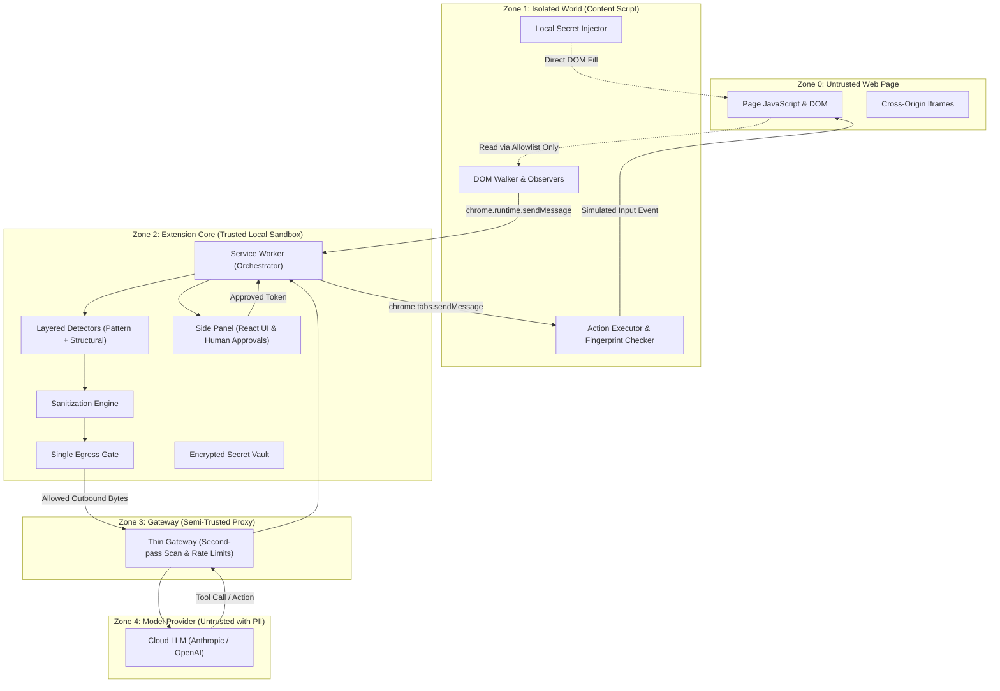
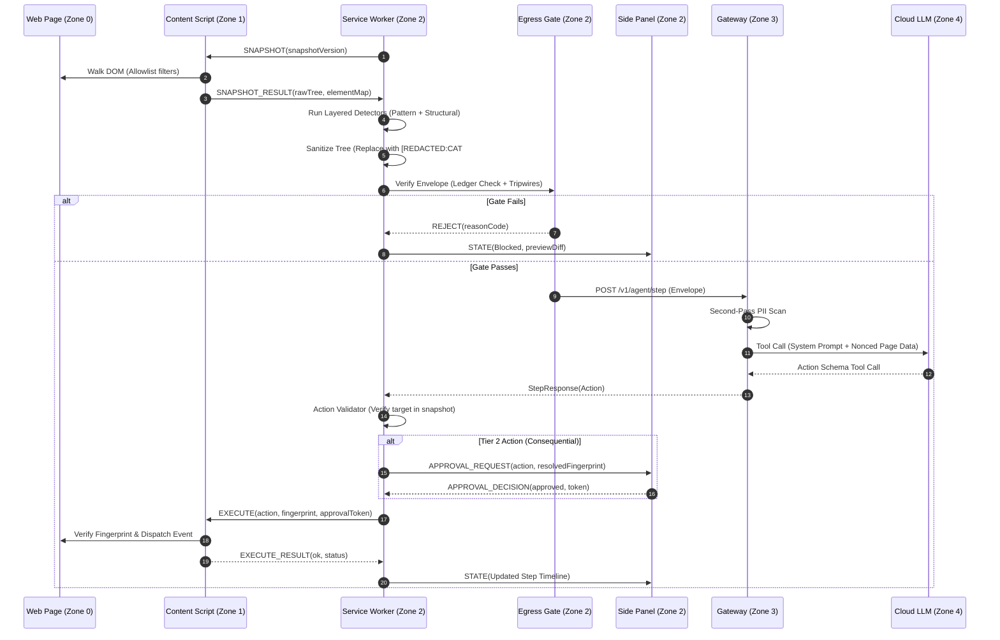
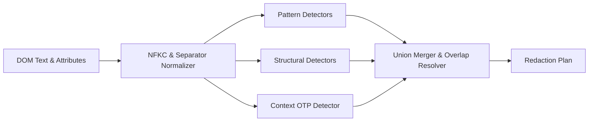
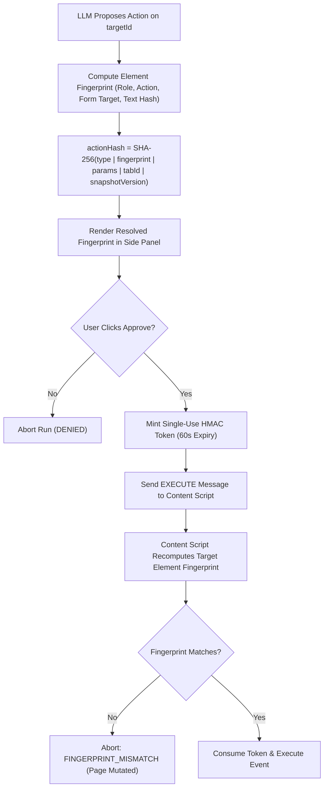

# PrivacyLens — System Design Document

> Chrome extension (Manifest V3) that lets an AI agent operate web pages while sensitive data never leaves the browser unredacted.  
> Core principle (from PS-004): **Compute what is sensitive locally. Reason globally only on sanitized data.**

Status legend: **[DECIDED]** settled · **[ASSUMPTION]** believed, not verified · **[OPEN]** needs a team decision · **[TARGET]** a goal, *not* a measured result.

---

## 1. Overview & Architectural Principles

1. **Compute Locally, Reason Globally**: All detection, pattern matching, structural heuristic analysis, and redaction execute inside the local browser extension sandbox. External LLMs receive strictly sanitized data.
2. **Single Egress Chokepoint**: Exactly one code path is permitted to transmit bytes outside the browser. Every outbound payload must pass through this gate.
3. **Fail Closed**: If any detector, serializer, validator, or gate check throws an error or exceeds a timeout, data transmission halts immediately and the step fails.
4. **Untrusted Page Boundary**: Web page DOM and scripts are untrusted input. The agent system never executes page-injected instructions or allows page scripts to interact with extension internals.
5. **Human in the Loop for Consequential Actions**: The AI proposes actions; the human authorizes high-risk operations via a secure, unforgeable side panel interface.

---

## 2. Trust Zones & Threat Boundaries



| Zone | Boundary / Component | Trust Level | Capabilities & Protections |
|---|---|---|---|
| **Zone 0** | Web Page DOM & Context | Untrusted | Contains raw PII, payment forms, user data, and potential prompt injection. Isolated from extension internals. |
| **Zone 1** | Content Script | Isolated | Executes in Chrome Isolated World. Can traverse DOM and simulate events. No direct network access (`fetch` disabled). |
| **Zone 2** | Service Worker & Side Panel | Fully Trusted | Controls run state, holds detector algorithms, runs the single egress gate, renders UI in side panel. |
| **Zone 3** | Thin Gateway | Semi-Trusted | Holds provider API keys off-client. Runs second-pass PII scan. Persists zero request bodies or session logs. |
| **Zone 4** | Cloud LLM Provider | Untrusted with PII | Receives only semantic placeholders (`[REDACTED:CARD]`) and sanitized structural accessibility trees. |

---

## 3. Monorepo Structure

```
.
├── apps/
│   ├── extension/             # Chrome Extension (MV3)
│   │   ├── entrypoints/
│   │   │   ├── background.ts  # Service worker orchestrator & egress gate
│   │   │   ├── content.ts     # Isolated world DOM walker & action executor
│   │   │   └── sidepanel/     # React UI (timeline, diff preview, approvals)
│   │   └── src/
│   │       ├── egress/        # Single egress chokepoint implementation
│   │       ├── run/           # Agent state machine & step limits
│   │       ├── snapshot/      # DOM serialization & fingerprinting
│   │       └── vault/         # AES-GCM client vault
│   └── gateway/               # Node 20+ Hono thin gateway
│       └── src/
│           ├── adapters/      # Anthropic, OpenAI, Ollama, Mock adapters
│           ├── routes/        # /healthz, /v1/auth/*, /v1/agent/step
│           └── scan/          # Second-pass scan engine
├── packages/
│   ├── protocol/              # Shared Zod schemas (Envelope, Action, Step)
│   └── detector/              # Pattern (Luhn/Verhoeff/Regex) & structural logic
└── eval/                      # Synthetic pages, canaries, and benchmark harness
    ├── pages/                 # Synthetic S1–S5 test fixtures
    ├── canaries/              # Algorithmic fake value generators
    └── runner/                # pnpm eval runner & leak assertion reporters
```

---

## 4. End-to-End Step Cycle



---

## 5. Snapshot Engine & DOM Allowlist

To prevent leaking hidden page variables, CSS secrets, or shadow DOM exploits, snapshots are constructed using a strict **node and attribute allowlist**.

### 5.1 Allowlist Rules
- **Allowed Elements**: `a`, `button`, `input`, `select`, `textarea`, `form`, `label`, `p`, `span`, `div`, `h1`–`h6`, `table`, `tr`, `td`, `th`, `ul`, `ol`, `li`.
- **Allowed Attributes**: `id`, `name`, `type`, `role`, `aria-label`, `placeholder`, `title`, `alt`, `href`, `value` (*strictly excluded on password inputs*), `disabled`, `checked`, `selected`.
- **Stripped Subtrees**: `<script>`, `<style>`, `<noscript>`, `<svg>`, `<canvas>`, `<iframe>` (rendered as placeholder node), hidden inputs (`input[type=hidden]`), elements with `display: none`, `visibility: hidden`, or `aria-hidden="true"`.
- **Dropped Attributes**: All `data-*` attributes, inline event handlers (`onclick`, etc.), arbitrary vendor attributes.

---

## 6. Snapshot & Protocol Schemas (`packages/protocol`)

```ts
import { z } from "zod";

// --- Node & Snapshot Representation ---
export const DOMNodeSchema: z.ZodType<DOMNode> = z.lazy(() =>
  z.object({
    id: z.string(),                     // Ephemeral node ID per snapshot
    tag: z.string(),
    role: z.string().optional(),
    name: z.string().optional(),        // Accessible name
    text: z.string().optional(),        // Visible text content (sanitized)
    attributes: z.record(z.string()).default({}),
    children: z.array(DOMNodeSchema).default([]),
    isInteractive: z.boolean().default(false),
  })
);

export type DOMNode = {
  id: string;
  tag: string;
  role?: string;
  name?: string;
  text?: string;
  attributes: Record<string, string>;
  children: DOMNode[];
  isInteractive: boolean;
};

export const SnapshotSchema = z.object({
  snapshotVersion: z.number().int(),
  tabId: z.number().int(),
  url: z.string().url(),
  title: z.string(),
  tree: DOMNodeSchema,
  timestamp: z.number(),
});
export type Snapshot = z.infer<typeof SnapshotSchema>;

// --- Action Definitions ---
export const ActionTypeSchema = z.enum([
  "click",
  "type",
  "select",
  "scroll",
  "navigate",
  "wait",
  "ask_user",
  "done",
  "fail",
]);

export const ActionSchema = z.object({
  type: ActionTypeSchema,
  targetId: z.string().optional(),      // Node ID in the snapshot
  value: z.string().optional(),         // Text to type or option to select
  secretRef: z.string().optional(),     // Named reference to local vault secret
  direction: z.enum(["up", "down"]).optional(),
  url: z.string().url().optional(),
  prompt: z.string().optional(),
  reason: z.string().optional(),
});
export type Action = z.infer<typeof ActionSchema>;
```

---

## 7. Layered Detection Engine

Detectors execute sequentially, outputting normalized findings. The merge policy is **union** (if any detector marks a span sensitive, it is redacted).



### 7.1 Detector Modules

| Module | Scope / Rules | Validation Algorithm |
|---|---|---|
| **Aadhaar** | 12-digit Indian National Identity Number | Verhoeff checksum algorithm; space/dash separator handling. |
| **PAN Card** | 10-char Indian Tax ID (`[A-Z]{5}[0-9]{4}[A-Z]`) | 4th char entity validation (`P`=Individual, `C`=Company, etc.). |
| **Credit/Debit Card** | 13–19 digit PANs | Luhn check; IIN/BIN prefix verification (Visa, MC, Amex, RuPay). |
| **CVV / Expiry** | 3–4 digit card security codes & date patterns | Proximity to card inputs or cardholder fields. |
| **Authentication** | Passwords & Session Keys | `input[type=password]`, high-entropy hex/base64 strings near keywords. |
| **OTP / 2FA** | 4–8 digit numeric codes | Proximity to keywords (`code`, `verification`, `otp`, `one-time`). |
| **Contact / PII** | Phone numbers (IN / E.164), Email addresses | E.164 parsing, standard RFC 5322 email regex. |
| **API Keys & Secrets** | Provider prefixes (`sk-`, `ghp_`, `AKIA`) | Prefix + entropy check; JWT structure validation (`ey...`). |

---

## 8. Sanitization Engine

1. **Semantic Replacement**: Sensitive spans are replaced with deterministic placeholder tokens:
   $$\text{Format: } \texttt{[REDACTED:<CATEGORY>#<INDEX>]}$$
   *Example:* `[REDACTED:CARD#1]`, `[REDACTED:CARD_EXPIRY#1]`, `[REDACTED:EMAIL#1]`.
2. **Disambiguation Indexing**: Repeating instances of identical values map to the same indexed placeholder within a run, allowing the model to correlate fields (e.g., matching confirmed email fields).
3. **Strict Irreversibility**:
   - Outbound representations contain zero partial reveals (no "last 4 digits", no masked hashes).
   - The bidirectional mapping $\text{Value} \leftrightarrow \text{Placeholder}$ lives strictly in ephemeral extension memory (`WeakMap` or session map) and is never sent to the network or written to unencrypted storage.

---

## 9. The Single Egress Chokepoint & Gate

Every outbound network byte must pass through `apps/extension/src/egress/gate.ts`. No other module is permitted to invoke `fetch()` or `XMLHttpRequest`.

### 9.1 Outbound Envelope Schema

```ts
export const EnvelopeSchema = z.object({
  requestId: z.string().uuid(),
  task: z.string(),
  snapshotVersion: z.number().int(),
  snapshot: DOMNodeSchema,              // Sanitized DOM tree
  availableSecrets: z.array(
    z.object({
      name: z.string(),                 // e.g. "card.number"
      type: z.string(),                 // e.g. "CARD"
    })
  ).default([]),
  redactionLedger: z.record(z.string(), z.number()), // Category -> count
  timestamp: z.number(),
});
export type Envelope = z.infer<typeof EnvelopeSchema>;
```

### 9.2 The 4-Stage Gate Inspection Pipeline

```
[Candidate Payload]
       │
       ▼
 1. Schema Validation        ──(Fail: Non-conforming structure)──► [BLOCK & ABORT]
       │
       ▼
 2. Destination Allowlist    ──(Fail: Host not in allowlist)   ──► [BLOCK & ABORT]
       │
       ▼
 3. Redaction Ledger Check   ──(Fail: Raw detected string found)─► [BLOCK & ABORT]
       │
       ▼
 4. Broad Tripwire Scan      ──(Fail: High-entropy secret match)─► [BLOCK & ABORT]
       │
       ▼
[PASS: Transmit via fetch()]
```

1. **Strict Schema Validation**: Verifies payload adheres 100% to `EnvelopeSchema` with `stripUnknown: false`. Unknown fields abort transmission.
2. **Destination Allowlist**: Re-asserts destination URL matches configured Gateway or Local Ollama port.
3. **Redaction Ledger Check**: Scans every string leaf in the serialized JSON against all raw strings recorded in the local detection ledger. If any raw sensitive substring is found in the outbound serialization, the request is immediately blocked (`GATE_LEDGER_LEAK`).
4. **Broad Tripwire Scan**: An independent set of high-recall regex patterns (credit cards, high-entropy tokens, Aadhaar, PAN) scans the serialized payload.
5. **Red-Team Tripwire Switch**: When enabled in options for auditing/demo, injects a simulated canary into the envelope to prove the gate blocks outbound transmission.

---

## 10. Risk Tiers, Action Space & Anti-TOCTOU Verification

### 10.1 Action Risk Tiers

| Tier | Category | Actions Included | Gating & Approval Policy |
|---|---|---|---|
| **Tier 0** | Read / Passive | `scroll`, `wait`, `ask_user`, `done` | Automatic execution without approval. |
| **Tier 1** | Benign Interaction | `click` (links, accordions, tabs), `select` (non-sensitive filters) | Validated against DOM tree; executed automatically. |
| **Tier 2** | Consequential / Mutating | `click` (Submit, Pay, Delete, Buy, Send), `type` (Vault `secretRef`), cross-origin navigation, form submission | **Requires Human Approval** in the side panel. Single-use cryptographic token required. |
| **Tier 3** | Prohibited | Direct script injection, reading password fields, downloading files, visiting blacklisted schemes (`file://`, `chrome://`) | **Permanently Blocked.** Throws execution error. |

### 10.2 Anti-TOCTOU Element Fingerprinting

To prevent Time-of-Check to Time-of-Use (TOCTOU) exploits where a webpage alters element roles or form actions between model proposal, user approval, and execution:



---

## 11. Local Secret Vault (`secretRef`)

To support automated checkout without cloud leakage (FR-C6):
1. **Local Storage**: User secrets (card numbers, CVVs, passwords) are stored encrypted via AES-GCM (PBKDF2-derived key) in `chrome.storage.local`.
2. **Sanitized Exposure**: Outbound envelopes expose only names: `availableSecrets: [{ name: "card.number", type: "CARD" }]`.
3. **Local Injection**: When the model emits `{ type: "type", targetId: "cc_input", secretRef: "card.number" }`:
   - Side panel displays: *"Authorize filling card.number into Payment Form on merchant.com"*.
   - Upon approval, the service worker decrypts the value in memory and dispatches it directly to the Content Script over an authenticated internal port.
   - The Content Script sets the HTML input value and dispatches input/change events, immediately dereferencing the plaintext from memory.

---

## 12. Evaluation Framework, Leakage Pathways & Metrics

### 12.1 Leakage Pathways (P1–P9)

The eval harness explicitly monitors and captures outbound data across all nine potential leakage pathways:

| Pathway | Source → Sink | Capture Mechanism |
|---|---|---|
| **P1** | DOM Tree Text → Outbound Envelope | Intercepted at Egress Gate. |
| **P2** | DOM Attributes (`href`, `placeholder`, `aria-label`) → Envelope | Intercepted at Egress Gate. |
| **P3** | Gateway → Model Provider API | Recorded via Gateway `CAPTURE_DIR` proxy seam. |
| **P4** | Extension Logging → Storage / Disk | Scanned across `chrome.storage.*` and console sinks. |
| **P5** | Error Bodies → Network Response | Gateway error responses checked for reflected matches. |
| **P6** | Extension State → Service Worker Crash Logs | Monitored in debug sessions. |
| **P7** | In-Memory Vault → Outbound Envelope | Asserted in Gate Ledger scan. |
| **P8** | Prompt Nonce / Delimiter Reflection | Evaluated in provider payload capture. |
| **P9** | Screenshot / Visual Stream (Phase 3) | Pixel inspection of offscreen canvas output. |

### 12.2 Formal Metric Definitions

1. **Detection Recall ($R_{\text{detect}}$)**:
   $$R_{\text{detect}} = \frac{|\text{Annotated Sensitive Spans} \cap \text{Redacted Spans}|}{|\text{Annotated Sensitive Spans}|} \times 100\%$$
   *Targets:* $\ge 98\%$ on tuned set; $\ge 90\%$ on held-out set.

2. **Redaction Precision ($P_{\text{redact}}$)**:
   $$P_{\text{redact}} = \frac{|\text{Redacted Spans that are Truly Sensitive}|}{|\text{Total Redacted Spans}|} \times 100\%$$
   *Target:* $\ge 90\%$.

3. **Canary Leakage Rate ($L_{\text{canary}}$)**:
   $$L_{\text{canary}} = \frac{\sum_{p \in \{P1 \dots P9\}} \text{Canaries Found in Pathway } p}{\text{Total Planted Canaries}} \times 100\%$$
   *Target:* **Strictly $0\%$ on all tested pathways.**

4. **Context Preservation ($C_{\text{pres}}$)**:
   $$C_{\text{pres}} = \frac{|\text{Actionable Interactive Elements Retained in Sanitized Tree}|}{|\text{Actionable Interactive Elements in Raw DOM}|} \times 100\%$$
   *Target:* $\ge 95\%$.

5. **Task Success Rate ($S_{\text{task}}$)**:
   $$S_{\text{task}} = \frac{\text{Successful Tasks on Sanitized View}}{\text{Successful Tasks on Raw Baseline}} \times 100\%$$
   *Target:* $\ge 80\%$.

---

## 13. Failure Modes, Degraded States & Recovery

| Failure Mode | Detection | System Response |
|---|---|---|
| **Gate Tripwire Hit** | Canary or PII detected at Egress Gate | Immediately aborts outbound fetch; marks step as `BLOCKED: TRIPWIRE_TRIGGERED`; notifies user in side panel. |
| **Fingerprint Mismatch** | Target element changed before execution | Content script aborts action execution; returns `FINGERPRINT_MISMATCH`; triggers new snapshot. |
| **Service Worker Inactivity** | Chrome MV3 terminates idle background script | Run state is continuously journaled to `chrome.storage.session`. On wakeup, SW re-hydrates active run state. |
| **Gateway Unreachable** | HTTP 5xx / Network connection drop | Backoff with single retry; if still unavailable, marks step `GATEWAY_UNAVAILABLE`; preserves user task. |
| **Cross-Origin Iframe** | Detected iframe violating same-origin policy | Default-deny policy: renders opaque placeholder node `[CROSS_ORIGIN_FRAME]`; marks as uninspected. |
